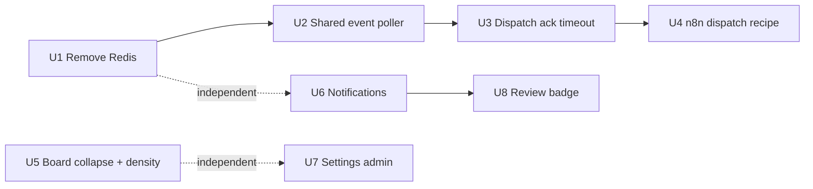
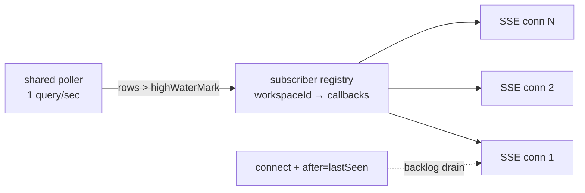
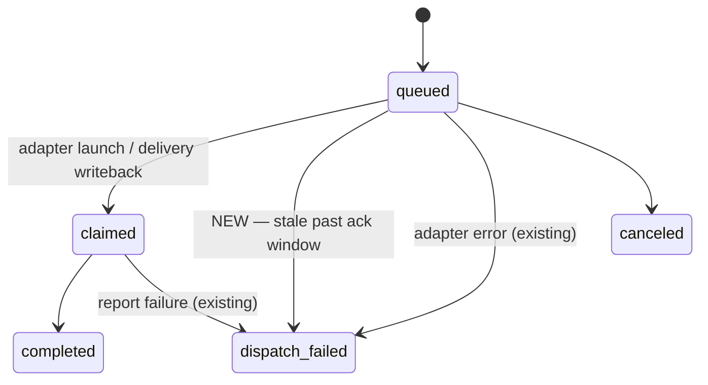

# feat: Next tier — platform hardening + dogfood-critical surfaces

## Goal Capsule

- **Objective:** The hosted dogfood instance runs on Postgres only, the event
  stream scales past per-connection polling, dispatches fail visibly instead
  of hanging silently, and a human can administer labels/projects/cycles and
  see pending notifications/reviews without leaving the app.
- **Means:** Execute the Next tier (roadmap U6–U10) under the owner's "clean
  simplified extreme UX" direction — remove rather than accumulate, document
  rather than build rule engines — plus the feature gaps dogfooding exposes
  (notifications, admin surfaces, review surfacing).
- **Stop conditions:** any unit that requires a new datastore, a rule engine,
  hosted-SaaS semantics, or mobile/responsive rework is out of scope — defer,
  don't absorb.

---

## Product Contract

### Summary

The roadmap's "Now" tier is done and deployed (U5 dogfood instance live at
tallyline.app). This plan executes the entire "Next" tier with the owner's
decisions applied, plus the product gaps that block real daily use:

| Roadmap unit | Decision taken | Lands as |
|---|---|---|
| U6 Redis | **Remove** — no consumer exists | U1 |
| U7 SSE polling | **Shared poller** — one query/sec process-wide | U2 |
| U8 agent sessions | **Ack timeout only** (roadmap's simpler alternative) | U3 |
| U9 transition dispatch | **Document the n8n recipe** — no rule engine | U4 |
| U10 web UI | Collapse-empty-columns + density, scoped | U5 |
| U11 WordInk | **Deferred** — blocked on owner's Phase 2 decision | — |
| Feature gaps | Notifications, labels/projects/cycles admin, review badge | U6, U7, U8 |

### Problem Frame

Self-hostability is the product's spine ("up and running in under 10
minutes"), yet the stack ships a Redis container that does nothing. The event
stream works but runs one DB query per second *per open connection* — fine
for one user, wrong shape for the agent-heavy future. Dispatches can sit
`queued` forever when a webhook endpoint is dead — silent failure is the
worst agent-platform failure mode. And the web app still can't create a label
or tell you a review is waiting: the dogfood loop has holes.

### Requirements

- **R1** — Redis is fully removed: no service in compose files, no `ioredis`
  dependency, no `REDIS_URL` env var, `/health` reports Postgres only.
  *(roadmap U6, open decision #1 — resolved: remove)*
- **R2** — The SSE event stream uses one shared poller per API process: at
  most ~1 events query/sec total regardless of connection count. Resume via
  `Last-Event-ID`/`?after=` and heartbeat behavior preserved.
  *(roadmap U7, simpler alternative chosen)*
- **R3** — A dispatch stuck `queued` past a configurable window flips to
  `dispatch_failed`, writes a system comment on the issue thread, and emits
  an event. The session timeline renders the failed state.
  *(roadmap U8, timeout-only scope)*
- **R4** — `docs/adapters.md` documents the transition-triggered dispatch
  recipe using the existing webhook surface (n8n or any consumer): filter on
  `issue` events where `after.state` changed, then trigger dispatch via the
  existing seams — `PATCH` the issue's assignee to the agent, or POST a
  comment containing `@agentname`. There is no public `POST /dispatches`;
  assignment and mention *are* the dispatch triggers.
  *(roadmap U9, documentation scope)*
- **R5** — The board is usable at 1440px: empty columns collapse, column set
  is capped at active states, card density matches DESIGN.md.
  *(roadmap U10, scoped — full virtualization only if free)*
- **R6** — Notifications exist: `notifications` table, list + mark-read
  endpoints, unread-count endpoint, and fan-out on mention / assign-to-human /
  review-pending / dispatch_failed. Nav shows an unread badge.
- **R7** — Settings gains working admin for labels (create/rename/recolor/
  delete) and minimal project + cycle creation — all doable without curl.
  Requires new API surface: labels currently expose only `GET` + `POST`
  (`apps/api/src/routes/issues.ts`); `PATCH`/`DELETE /labels/:id` are built
  here. Projects and cycles already have full CRUD in
  `apps/api/src/routes/resources.ts` — bridge-only work.
- **R8** — A pending-review count is visible in the app nav.

### Key Decisions (product-level)

- **Remove over keep-dormant** — Governs R1: no "might need it later"
  container; the upgrade path is re-adding it when a real consumer appears.
- **Docs over engines** — Governs R4: a rule engine means storage + admin UI
  + loop prevention; the webhook surface already expresses the whole thing.
- **Timeout over protocol** — Governs R3: skip Linear's delegate field and
  session schema until a second agent-on-human-issue use case exists.
- **Dogfood-completeness over roadmap-purity** — Governs R6–R8: these three
  surfaces are what make the deployed instance actually usable daily.

### Scope Boundaries

**Deferred to follow-up work:**
- U11 WordInk voice intake — blocked on the owner's WordInk Phase 2 decision;
  `POST /issues` (state `triage`) already covers intake meanwhile.
- Saved-views UI — `views` table + `GET/POST /workspaces/:ws/views` already
  exist in `apps/api/src/routes/resources.ts`; exposing them is its own unit.
- `delegate` field / full Linear session protocol (roadmap U8 remainder).
- `LISTEN/NOTIFY` push — the upgrade path if shared polling proves slow.
- Full board virtualization, drag-state design, mobile/responsive, light
  theme, pixel polish, motion sweeps (the "facelift" — post-feature).

**Outside this product's identity:** hosted multi-tenant SaaS, an in-app
automation/rule engine, anything requiring Redis back.

### Actors

- **Human member** — triages, reviews, administers labels/cycles, receives
  notifications.
- **Agent (API key)** — claims, works, reports session events; its dispatch
  can now visibly fail.
- **System sweeper** — the existing `setInterval` job loop in
  `apps/api/src/index.ts` gains a dispatch-timeout check.

---

## Planning Contract

### Key Technical Decisions

- **KTD1 — Redis removal is a deletion, not a config flag.** Touch points:
  `apps/api/src/health.ts`, `env.ts`, `index.ts`, `openapi.ts`,
  `docker-compose.yml`, `docker-compose.selfhost.yml`,
  `tools/e2e/docker-compose.e2e.yml`, `.github/workflows/check.yml`,
  `docs/deploy.md`, `CONTRIBUTING.md`, `apps/api/package.json` (ioredis),
  `apps/api/scripts/mcp-sdk-conformance.ts`, `apps/api/test/db-guard.*`.
  Deploy note: cluster2's running stack loses the `tallyline-redis-1`
  container and the api's `REDIS_URL` — compose recreate required.
- **KTD2 — Shared poller as a module-level registry.** One
  `setInterval`-driven loop in `apps/api/src/routes/events.ts` (or a new
  `services/event-hub.ts`) maintains `highWaterMark` = max seen `events.id`;
  each poll does one `feedEventsQuery(gt(highWaterMark))`, then fans matching
  rows to per-workspace subscriber callbacks. SSE handlers subscribe on
  connect, replay from `lastSeen`, unsubscribe on abort. New workspaces a
  subscriber hasn't seen yet still get rows — subscribers filter by
  `workspaceId`, the poller is workspace-agnostic (or per-workspace lazily;
  pick during implementation — workspace-agnostic is simpler).
- **KTD3 — Ack timeout as a third sweeper.** Mirror `sweepDeliveries` /
  `sweepExpiredCycles`: `sweepStaleDispatches()` on an interval in
  `index.ts`, `DISPATCH_ACK_TIMEOUT_MS` env (default ~60s suggested;
  Linear's bar is 10s — pick deliberately, don't copy the number). Targets
  `status='queued'` rows older than the window → reuse the existing `fail()`
  in `services/dispatch.ts` (already writes status + event + thread comment +
  outbound delivery). `claimed` dispatches are out of scope — claiming means
  something acknowledged.
- **KTD4 — Notifications materialized at write time.** New `notifications`
  table: `workspaceId, userId, kind, issueId?, eventId?, readAt?, createdAt`.
  Fan-out points: `services/issues.ts` assign-to-human, comments mention
  parse (see below), `issues.ts` review-pending transitions → owner+admin
  members, `dispatch.ts` `fail()` → the dispatching actor if human, else
  workspace owners. Endpoints under `/v1/workspaces/:ws/notifications`
  (list, `POST :id/read`, `POST read-all`, `GET unread-count`).
  **Human mentions are new work:** the comment path at `issues.ts` ~L602
  parses `@name` against `agents` only — U6 adds a parallel `users` lookup
  against workspace members, so `@alice` notifies Alice while `@agentname`
  still dispatches. Same mention string can hit both; that's correct
  (notification + dispatch are independent effects).
- **KTD5 — Admin surfaces follow existing settings conventions.**
  Server-rendered pages under `app/(app)/settings/{labels,projects,cycles}/`
  using the same fetch-via-bridge pattern as `settings/members`; label form
  reuses the Silver Lining token palette (no new colors — pick from the
  existing label color set the API already stores).
- **KTD6 — Review badge rides the notifications count.** One combined badge
  fetch (`unread-count` + `pending-review-count`) or fold pending-review
  into the unread count — decide at implementation; cheapest correct option
  wins. Nav already re-renders per page (server layout).

### Sequencing

U1→U2→U3→U4 is the platform spine (each builds on the previous being settled).
U5, U6, U7 are independently landable; U8 depends on U6's count endpoint.
Suggest one PR per unit; U6+U8 may share a PR if the badge lands inside the
notifications UI.

### Assumptions

- Cluster2's compose stack is maintained outside this repo (or generated);
  removing redis there is an operational step paired with the U1 deploy, not
  a code change.
- Agent `@mention` parsing verified at `issues.ts` ~L602 (agents-only);
  human-mention lookup is new U6 work, not an assumption.
- The 1-second poll acceptance bar ("~1s cross-client") stands; shared
  polling preserves it exactly.

### High-Level Technical Design

Event hub (KTD2) — one poller, N subscribers:

Dispatch lifecycle (KTD3) — the timeout edge this plan adds:

---

## Implementation Units

### U1. Remove Redis from the stack

**Goal:** Postgres is the only datastore; the self-host compose ships three
services (postgres, api, web) plus the optional mcp profile.
**Requirements:** R1
**Dependencies:** none
**Files:**
- `apps/api/src/health.ts` — drop `pingRedis`, `redis` field, `Redis` import
- `apps/api/src/env.ts` — drop `REDIS_URL`
- `apps/api/src/index.ts` — drop `redisUrl` plumbing into health
- `apps/api/src/openapi.ts` — health schema loses `redis`
- `apps/api/package.json` — remove `ioredis`
- `docker-compose.yml`, `docker-compose.selfhost.yml` — drop redis service,
  `depends_on`, volume, `REDIS_URL` env line
- `tools/e2e/docker-compose.e2e.yml` — drop redis service
- `.github/workflows/check.yml` — drop the redis service container if present
- `docs/deploy.md`, `CONTRIBUTING.md`, `CHANGELOG.md` — update claims
- `apps/api/scripts/mcp-sdk-conformance.ts`, `apps/api/test/db-guard.*` —
  remove `REDIS_URL` references

**Approach:** Search `--files-with-matches "ioredis|REDIS_URL|redis"` at
implementation time and audit every hit — the planning grep already found
~15 files including built `dist/` (regenerate, don't edit). Health report
becomes `{ status, postgres, uptimeSeconds }`; `status` is `ok` when postgres
pings, `degraded` otherwise.
**Test scenarios:**
- Happy: `/health` returns 200 with `postgres: true`, no `redis` key.
- Failure: kill postgres → `degraded` (existing behavior, keep).
- Config: booting without `REDIS_URL` set works; booting *with* it set is
  tolerated-but-ignored or rejected — pick strict-remove semantics.
**Verification:** `pnpm check` green; selfhost compose up shows no redis
container; e2e suite passes without a redis service.

### U2. Shared events poller (replace per-connection polling)

**Goal:** N open SSE connections cost 1 poll/sec total, not N.
**Requirements:** R2
**Dependencies:** U1 (post-Redis world — no temptation to reach for pub/sub)
**Files:**
- `apps/api/src/routes/events.ts` — extract stream loop
- `apps/api/src/services/event-hub.ts` *(new)* — shared poller + subscriber
  registry
- `apps/api/src/routes/events.test.ts` — connection-count test

**Approach:** Module-level `Map<workspaceId, Set<subscriber>>` (or a single
workspace-agnostic poller — simpler; subscribers filter). One interval does
`feedEventsQuery(gt(highWaterMark), asc, BATCH_SIZE)`; on rows, advance
`highWaterMark` and invoke each subscriber with rows matching its
`workspaceId`. SSE handler: subscribe → drain backlog from `lastSeen` via
direct query (unchanged resume path) → write pushed rows → heartbeat →
unsubscribe on `done`. Keep the existing `try/catch` around polls — a
transient failure skips a tick, never kills the loop. Start the poller lazily
on first subscriber; stop it when subscriber count hits zero.
**Patterns to follow:** the stop/abort machinery already in the stream
handler (`stopper`, `reqSignal` listener, `stream.onAbort`) — move it, don't
rewrite it.
**Test scenarios:**
- Integration: open 3 SSE streams on one workspace, write 1 event, assert all
  3 receive it and a query counter shows ~1 query/sec total.
- Edge: subscriber connecting mid-burst replays correctly via `after=` cursor.
- Edge: last subscriber disconnecting stops the poller; reconnect restarts.
- Failure: a throwing poll doesn't kill subsequent ticks or streams.
**Verification:** connection-count test proves no per-connection query loop;
existing `events --follow` CLI behavior unchanged; e2e keymap/board specs
still meet the ~1s latency bar.

### U3. Dispatch ack timeout

**Goal:** A dispatch that no agent ever acknowledged fails loudly within a
configured window instead of sitting `queued` forever.
**Requirements:** R3
**Dependencies:** none (uses existing `fail()` path)
**Files:**
- `apps/api/src/services/dispatch.ts` — `sweepStaleDispatches()` export
- `apps/api/src/index.ts` — third `setInterval` registration
- `apps/api/src/env.ts` — `DISPATCH_ACK_TIMEOUT_MS` (suggest default 60_000)
- `apps/api/src/services/dispatch.test.ts` — timeout tests
- `apps/web/components/session-timeline.tsx` — `dispatch_failed` terminal
  state styling (verify current coverage first)

**Approach:** `sweepStaleDispatches(now)` selects `dispatches` where
`status='queued'` AND `createdAt < now - window` → `fail(dispatch,
"no acknowledgement within <window>")`. Reuse `fail()` verbatim — it already
writes status, event, thread comment, and outbound delivery. Register in
`index.ts` beside the other two sweeps, interval ~ window/2 or a fixed 10s.
`claimed` rows are not swept (claim = ack).
**Test scenarios:**
- Happy: a `queued` dispatch older than the window becomes `dispatch_failed`
  with a thread comment and a `dispatch_failed` event.
- Edge: a `queued` dispatch younger than the window is untouched.
- Edge: `claimed`/`completed`/`canceled` rows are never swept.
- Config: window reads from env; a disabled/0 window skips the sweep
  (decide semantics at implementation).
**Verification:** API tests green; a killed webhook endpoint produces a
visible `dispatch_failed` + thread comment on the issue.

### U4. Document transition-triggered dispatch via webhooks

**Goal:** The "state→todo + label X ⇒ dispatch agent Y" story is a documented
recipe, not code.
**Requirements:** R4
**Dependencies:** U3 (so the recipe's failure mode — dispatch_failed — is
observable)
**Files:**
- `docs/adapters.md` — new recipe section
- `docs/webhooks.md` — cross-link + event-shape reference if missing

**Approach:** Document the consumer pattern: subscribe a webhook endpoint to
`issue.*` actions → inspect `after.state` / labels in the payload → trigger
the dispatch by `PATCH`-ing the issue's assignee to the agent (the `assign`
trigger) or posting an `@agentname` comment (the `mention` trigger) — both
already funnel into `createDispatch`. Include an n8n node sketch (the n8n
trigger node already exists). Explicitly document loop safety: webhook
consumers must filter on `after.state` *changing*, not on any issue event,
or a dispatch that mutates the issue re-triggers itself.
**Test expectation:** none — docs-only unit.
**Verification:** a reader can wire the recipe without reading source; the
doc names the exact event actions and dispatch endpoint.

### U5. Board overflow + density pass

**Goal:** The board is honest at 1440px: empty columns collapse, the column
set reflects active states, cards carry the density PR #122 established.
**Requirements:** R5
**Dependencies:** none
**Files:**
- `apps/web/components/board-client.tsx` — collapse-empty + column rules
- `apps/web/app/(app)/board/page.tsx` — column source-of-truth if needed
- `apps/web/lint-design-allowlist.json` — only to ratchet *down*

**Approach:** Collapse empty columns into a compact "+ N empty states" rail
or zero-width stubs (pick what DESIGN.md's board anatomy implies — it's a
Known Gap, so set the minimal sane rule: empty non-terminal columns collapse,
`triage`/`done`/`canceled` always render). Do not build virtualization unless
card count per column demonstrably needs it — the roadmap's own simpler
alternative is collapse-first. All new styles inside the Silver Lining scale
(11/12/13/14/15/17/24px) and tokens.
**Test scenarios:**
- Visual/e2e: board with 6 states and several empty columns fits 1440px
  without horizontal scroll.
- Edge: a state with 1 card never collapses.
- Edge: dropping the last card out of a column collapses it live.
**Verification:** `perf.spec.ts` + `a11y.spec.ts` pass; `pnpm lint:design`
shows no new violations (allowlist ratchets down, never up).

### U6. Notifications

**Goal:** Members learn about mentions, assignments, review-pending, and
failed dispatches inside the app.
**Requirements:** R6
**Dependencies:** none
**Files:**
- `apps/api/src/db/schema.ts` + new drizzle migration — `notifications` table
- `apps/api/src/services/notifications.ts` *(new)* — fan-out helpers
- `apps/api/src/routes/notifications.ts` *(new)* — list/read/read-all/count
- `apps/api/src/routes/notifications.test.ts` *(new)*
- `apps/api/src/services/issues.ts`, `dispatch.ts`, comments mention path —
  call fan-out at write time
- `apps/api/src/openapi.ts` — document the routes
- `apps/web/components/` — bell/badge in the app layout nav
- `apps/web/app/api/notifications/` *(new bridge routes)*

**Approach:** Table shape per KTD4. Fan-out targets: assignment to a human
assignee; `@mention` of a member in a comment; issue entering `in_review` →
workspace owners+admins; `dispatch_failed` → the human who triggered it
(fall back to owners). List newest-first, paginated like `events` (reuse
`decodeCursor`/`encodeCursor`). Badge: `GET unread-count` on layout load —
no SSE needed for v1 (the activity stream already exists if a live badge is
wanted later).
**Test scenarios:**
- Happy: assigning a human creates exactly 1 notification for that user.
- Happy: mention in a comment notifies the mentioned member only.
- Integration: `in_review` transition notifies owner+admin members.
- Edge: self-assignment / self-mention does not notify (decide; default: no
  self-notification).
- Authz: users see only their own notifications; agent keys get 403.
- Failure: mark-read on another user's notification → 404/403, no change.
**Verification:** API tests with real Postgres cover all rows above; badge
renders count on prod-shaped data; `pnpm check` green.

### U7. Settings admin: labels, projects, cycles

**Goal:** A member can manage labels and create projects/cycles entirely in
the UI.
**Requirements:** R7
**Dependencies:** none
**Files:**
- `apps/web/app/(app)/settings/labels/page.tsx` *(new)*
- `apps/web/app/(app)/settings/projects/page.tsx` *(new)*
- `apps/web/app/(app)/settings/cycles/page.tsx` *(new)*
- `apps/web/app/(app)/settings/page.tsx` + nav — link the new sections
- `apps/api/src/routes/issues.ts` — `PATCH` + `DELETE /workspaces/:ws/labels/:id`
- `apps/api/src/routes/api.test.ts` — label PATCH/DELETE coverage
- `apps/api/src/openapi.ts` — document label PATCH/DELETE
- `apps/web/app/api/labels/route.ts` — extend to POST bridge (GET exists from
  PR #123); `app/api/labels/[id]/route.ts` *(new)* — PATCH/DELETE bridges
- `apps/web/app/api/projects/`, `apps/web/app/api/cycles/` *(new bridges)*

**Approach:** Two halves. **API half (labels):** add
`PATCH /workspaces/:ws/labels/:id` (name, color) and
`DELETE /workspaces/:ws/labels/:id` — decide delete semantics at
implementation (cascade `issueLabels` joins vs. 409 when in use; cascade is
the Linear answer, a confirm gate in UI makes it safe). Follow the existing
label POST's validation style in the same file. **UI half:** mirror
`settings/members` — server component fetches via `api<T>()`, table/list +
create form, mutations through bridge routes + `revalidatePath`. Label
editor offers the existing label color set (check the seeded colors; reuse,
don't invent a picker). Projects/cycles UI needs only *create* for v1.
**Patterns to follow:** label validation/transaction style in
`apps/api/src/routes/issues.ts` (~L755); settings page conventions in
`app/(app)/settings/members/page.tsx`; bridge pattern in
`app/api/issues/[key]/route.ts`.
**Test scenarios:**
- Happy: create label → appears in list → usable in the issue label picker.
- Happy: rename/recolor label persists across reload.
- Edge: deleting a label in use — surface the API's actual behavior (verify
  whether delete cascades or 409s; document whichever exists).
- Failure: duplicate label name → API error renders, no silent fail.
**Verification:** flows work end-to-end in the browser; e2e suite green;
design gate clean.

### U8. Review queue badge

**Goal:** The pending-review count is ambient — visible without navigating to
`/review`.
**Requirements:** R8
**Dependencies:** U6 (badge/count plumbing)
**Files:**
- `apps/api/src/routes/notifications.ts` or `issues.ts` — pending-review
  count endpoint (or fold into unread-count response)
- `apps/web/app/(app)/layout.tsx` — nav badge next to the Review link

**Approach:** A `GET /workspaces/:ws/review-queue` route already exists in
`dispatches.ts` returning full rows — the badge only needs a count. Cheapest
correct option per KTD6: a `pendingReviewCount` field on the unread-count
response keeps it one fetch and avoids shipping full rows to every layout
render. Badge uses the same visual token as the notification badge; hide at
zero.
**Test scenarios:**
- Happy: 2 issues in `in_review` → badge shows 2.
- Edge: zero pending → no badge (not "0").
- Authz: count reflects workspace scope; agents excluded by the route's
  human-identity rule.
**Verification:** badge visible on every `(app)` page; count matches
`/review` contents.

---

## Verification Contract

- `pnpm check` — full typecheck + lint + tests across the monorepo.
- `pnpm --filter @tallyline/api test` — API suite is real-Postgres; all new
  behaviors get happy/edge/failure/authz cases per the unit scenarios.
- `pnpm lint:design` + `pnpm test:contrast` — new UI stays inside Silver
  Lining; allowlist only ever ratchets down.
- `pnpm e2e` — Playwright specs must pass; U2/U5 explicitly covered by the
  connection-count and board-overflow checks.
- Deploy gate: U1 requires recreating the cluster2 stack (redis container
  removed, `REDIS_URL` gone) — pair the deploy with a `docker compose ps`
  check and `/health` verification.

## Definition of Done

- All eight units merged; every unit's test scenarios exist as real tests
  (API tests on Postgres, web/e2e where UI-facing).
- `docker compose -f docker-compose.selfhost.yml config` shows no redis.
- `/health` returns `{ status, postgres, uptimeSeconds }`.
- Three SSE connections + one write = one event row fan-out, ~1 query/sec
  total measured in the U2 test.
- A dead webhook endpoint produces `dispatch_failed` + thread comment within
  the configured window on a live issue.
- `docs/adapters.md` contains the transition-dispatch recipe.
- Board fits 1440px without horizontal scroll; empty columns collapse.
- Bell badge shows unread notifications; Review badge shows pending count;
  labels can be created entirely in Settings.
- No abandoned-attempt code in the diff — dead poller branches, unused
  ioredis imports, and half-built admin pages are removed, not commented out.
- CHANGELOG updated per repo convention; ROADMAP.md Next-tier statuses
  flipped to shipped where landed.

## Open Questions

- **Ack-timeout default** (deferred to implementation): Linear's bar is 10s;
  self-hosted webhook agents may need longer. Suggested 60s — confirm at PR
  review, not blocking.
- **Self-notification policy** (deferred): default is no self-notifications;
  flip in the unit if review disagrees.
- **Saved views** (deferred): the API exists — whether the UI exposes them is
  a product call for the next plan.
